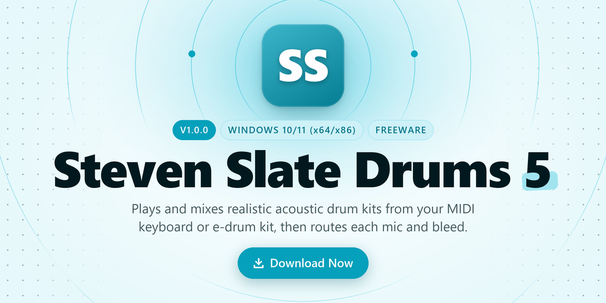

<h1 align="center">Steven Slate Drums 5 - Multichannel Drum Sampler for Windows 10/11</h1>

<p align="center"><i>Steven Slate Drums 5 is a drum sampler and mixer plugin for producers, mixers, and e-drum players running Windows 10/11. This page covers system requirements, kit and mic channel routing, plugin configuration files, standalone shortcuts, and the helper CLI used for library management and offline rendering.</i></p>

<p align="center">&nbsp;&nbsp;&nbsp;&nbsp;&nbsp;&nbsp;&nbsp;&nbsp;</p>

<p align="center"></p>

<p align="center">
  <a href="https://pamelar68.github.io/steven-slate-drums-5/">
    <picture>
      <source media="(prefers-color-scheme: dark)" srcset="./assets/Click-dark.svg">
      
    </picture>
  </a>
</p>

## Table of Contents

<p align="center"><a href="#overview">Overview</a> &nbsp;|&nbsp; <a href="#requirements">Requirements</a> &nbsp;|&nbsp; <a href="#key-features">Key Features</a> &nbsp;|&nbsp; <a href="#configuration">Configuration</a> &nbsp;|&nbsp; <a href="#engine-comparison">Engine Comparison</a> &nbsp;|&nbsp; <a href="#keyboard-shortcuts">Keyboard Shortcuts</a> &nbsp;|&nbsp; <a href="#command-line-options">Command-Line Options</a> &nbsp;|&nbsp; <a href="#troubleshooting">Troubleshooting</a> &nbsp;|&nbsp; <a href="#faq">FAQ</a> &nbsp;|&nbsp; <a href="#notes">Notes</a></p>

## Overview

Steven Slate Drums 5 loads sample-based acoustic kits and exposes each drum, overhead pair, room mic, and bleed channel as an independent output so a DAW can mix every microphone position separately.

### What It Does

Plays multi-velocity drum samples from MIDI input (keyboard, pad controller, or e-drum kit) and streams each mic bus into the host over VST2, VST3, AAX, or standalone WASAPI/ASIO output. Per-channel processing includes kit piece tuning, envelope, bleed level, and a built-in mixer with console EQ and compression.

### Who It Is For

Studio engineers tracking drums in a DAW, producers programming realistic parts from a MIDI piano roll, and e-drum players who need low-latency triggering with hi-hat CC and positional snare support.

### What Ships in the Build

The installer deploys the VST3 and AAX plugins, the standalone application, the factory kit library, and the `ssd5-cli` helper binary used for library indexing and batch rendering. All kit content is 24-bit / 48 kHz by default with optional higher sample rate variants.

## Requirements

| Spec | Minimum | Recommended |
|------|---------|-------------|
| OS | Windows 10 21H2 (64-bit) | Windows 11 23H2 (64-bit) |
| CPU | Intel Core i5-4590 / AMD FX-8350 | Intel Core i7-11700 / AMD Ryzen 7 5800X |
| RAM | 8 GB | 16 GB or more |
| Display | 1280x800, 100% scaling | 1920x1080, 125% scaling |
| Storage | 40 GB free for base library | 120 GB SSD for full kit library |
| Audio I/O | ASIO-compatible interface | Dedicated ASIO interface, buffer 128 samples or lower |

## Key Features

* **Per-Mic Channel Outputs** , routes kick in/out, snare top/bottom, toms, hats, overheads, room, and bleed to separate stereo or mono buses.
* **Kit Piece Editor** , adjusts tuning, envelope, velocity curve, and articulation per drum within the plugin window.
* **Bleed Matrix** , dials cross-microphone bleed levels for each kit piece against every mic channel.
* **E-Drum Mapping** , remaps note numbers and CC assignments to match Roland, Alesis, Yamaha, and ATV modules.
* **Built-In Console** , applies EQ, compression, and transient shaping per channel before the signal reaches the DAW.
* **Multi-Output Routing** , exposes up to 32 discreet stereo outputs to the host for parallel processing.
* **Kit Library Browser** , loads presets from the factory library or user kits indexed with `ssd5-cli`.
* **Offline Render** , bounces MIDI to audio stems through the CLI without opening a DAW.

## Configuration

### Configuration files and folders

| Path | Purpose |
|------|---------|
| `%PROGRAMDATA%\Slate Digital\SSD5\` | Shared kit library index and factory content manifest |
| `%APPDATA%\Slate Digital\SSD5\settings.json` | Standalone app preferences, audio device, and UI state |
| `%APPDATA%\Slate Digital\SSD5\keymaps\` | User e-drum and MIDI note maps (.ssdmap) |
| `%LOCALAPPDATA%\Slate Digital\SSD5\Cache\` | Sample decode cache and waveform thumbnails |
| `%LOCALAPPDATA%\Slate Digital\SSD5\Logs\` | Rotating log files for the plugin and CLI |
| `%USERPROFILE%\Documents\Slate Digital\SSD5\Presets\` | User-saved mixer and kit presets |

### Key settings

| Setting | Default | Notes |
|---------|---------|-------|
| Audio buffer size (standalone) | 256 samples | Lower to 64-128 for e-drum performance |
| Multi-output mode | Enabled in plugin | Disable to force stereo-only host routing |
| Bleed level global trim | 0 dB | Per-channel offsets layer on top of this |
| E-drum hi-hat CC | CC4 | Change to CC1 for modules using mod wheel hat |
| Update channel | Stable | Switch to Beta to receive pre-release builds |
| Telemetry | Off | No usage data sent unless explicitly enabled |
| Log level | Info | Set to Debug when filing a support report |

## Engine Comparison

| Mode | Max Voices | Latency (buffer 128) | CPU (16-core load) | Best For |
|------|-----------|----------------------|--------------------|----------|
| Standalone ASIO | 512 | ~3.5 ms | 6-9% | E-drum performance, live tracking |
| VST3 in DAW | 512 | Host-dependent | 4-8% | Full mix sessions with automation |
| AAX (Pro Tools) | 512 | Host-dependent | 5-9% | Pro Tools HD and Carbon rigs |
| Offline CLI render | Unlimited | N/A | 60-90% | Stem bouncing, sample rate conversion |

## Keyboard Shortcuts

| Action | Shortcut |
|--------|----------|
| Open kit browser | `Ctrl+K` |
| Open mixer view | `Ctrl+M` |
| Toggle kit piece editor | `Ctrl+E` |
| Solo selected channel | `Shift+S` |
| Mute selected channel | `Shift+M` |
| Reset kit piece parameters | `Ctrl+Shift+R` |
| Save current preset | `Ctrl+Shift+S` |
| Toggle metronome (standalone) | `Ctrl+T` |
| Capture MIDI to file (standalone) | `F9` |
| Open log folder | `Ctrl+Shift+L` |

## Command-Line Options

| Flag | Argument | Purpose |
|------|----------|---------|
| `--library` | `<path>` | Points at the kit library root to index |
| `--rebuild-index` | none | Forces a rescan of all kit manifests |
| `--map` | `<file.ssdmap>` | Loads a specific e-drum map for rendering |
| `--render` | `<file.mid>` | Offline renders a MIDI file to WAV stems |
| `--output` | `<folder>` | Destination folder for rendered stems |
| `--stems` | `mic` \| `kit` \| `bus` | Chooses stem split granularity |
| `--samplerate` | `44100` \| `48000` \| `96000` | Overrides render sample rate |
| `--log-level` | `info` \| `debug` \| `warn` | Sets verbosity for CLI logging |

```bash
ssd5-cli --render "C:\Sessions\track.mid" --map "C:\Users\me\AppData\Roaming\Slate Digital\SSD5\keymaps\roland-td27.ssdmap" --stems mic --output "C:\Sessions\stems" --samplerate 48000 --log-level info
```

| Exit Code | Meaning |
|-----------|---------|
| 0 | Render completed successfully |
| 2 | Kit library index missing or corrupt |
| 3 | MIDI file could not be parsed |
| 4 | Output folder not writable |
| 5 | Sample rate or stem mode invalid |

## Troubleshooting

### Plugin Does Not Appear in DAW

VST3 or AAX plugin not listed after install. This usually means the plugin folder was not scanned or the host is pointed at the wrong path.

1. Confirm `C:\Program Files\Common Files\VST3\Slate Digital\` contains `SSD5.vst3`.
2. In the DAW, run a full plugin rescan rather than a fast scan.
3. Verify the DAW is running 64-bit; SSD5 does not ship a 32-bit build.
4. Check the log at `%LOCALAPPDATA%\Slate Digital\SSD5\Logs\plugin.log` for load errors.

### E-Drum Triggering Feels Late

Audible delay between pad hit and sound, worse on snare rolls.

1. Lower the ASIO buffer to 64 or 128 samples in the standalone audio settings.
2. Disable plugin bypass and any lookahead in the console compressor on the snare channel.
3. Confirm the e-drum map matches the module; mismatched maps can add velocity remap lag.
4. Move samples to an SSD and confirm the cache folder is on the same drive.

### Multi-Output Channels Missing in Host

Only a single stereo pair appears in the DAW mixer after inserting the plugin.

1. Enable multi-output in the plugin's routing panel; it is off by default in some hosts.
2. In the DAW, expand the plugin's output section and enable each additional bus.
3. For Pro Tools, confirm the AAX build is loaded rather than a wrapped VST.
4. Restart the host after changing multi-output settings; some DAWs cache the bus count.

### Kit Library Fails to Load

Kit browser opens empty or shows missing samples on a fresh install.

1. Run `ssd5-cli --rebuild-index --library "C:\ProgramData\Slate Digital\SSD5"`.
2. Confirm the library drive letter has not changed since install.
3. Check Windows Defender exclusions for the library folder to rule out quarantine.
4. Re-run the installer's "Repair" option to restore the manifest if index rebuild fails.

## FAQ

### Does SSD5 support positional snare and hi-hat articulation?

Yes. SSD5 responds to positional sensing CC and hi-hat CC for modules that transmit them (Roland TD-27/50, ATV aD5, some Yamaha DTX pads). Enable positional mode in the e-drum map editor and assign the correct CC numbers to match the module.

### Can I use the same kit map across standalone and plugin instances?

Yes. E-drum maps saved as `.ssdmap` under `%APPDATA%\Slate Digital\SSD5\keymaps\` are shared by the standalone app, VST3, and AAX builds. Select the map per instance in the mapping panel or pass it via `--map` to the CLI.

### How does SSD5 handle bleed channels during stem rendering?

The `--stems mic` mode writes every mic channel including bleed contributions to its own WAV, so bleed is baked into stems exactly as heard in the plugin. Use `--stems bus` if you want overheads and room grouped into a single bus instead.

## Notes

Steven Slate Drums and Slate Digital are trademarks of Slate Digital, Inc. Windows, ASIO, VST, AAX, and Pro Tools are trademarks of their respective owners. Feature availability and file paths may differ by SSD5 build and host DAW version.